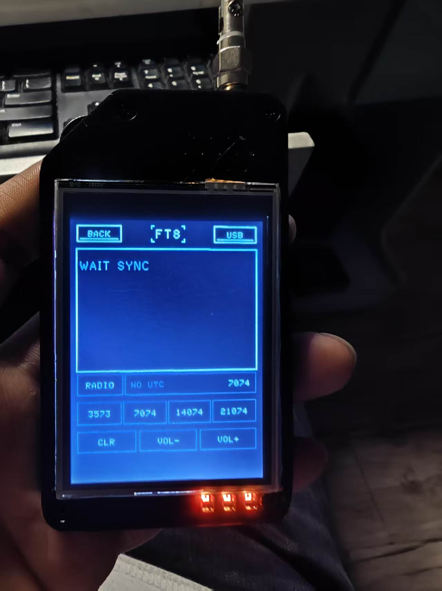
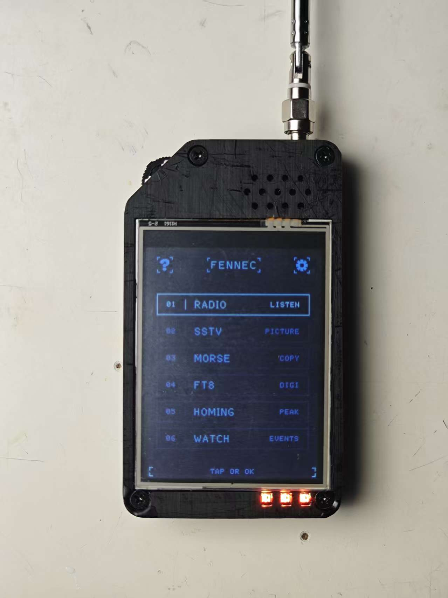
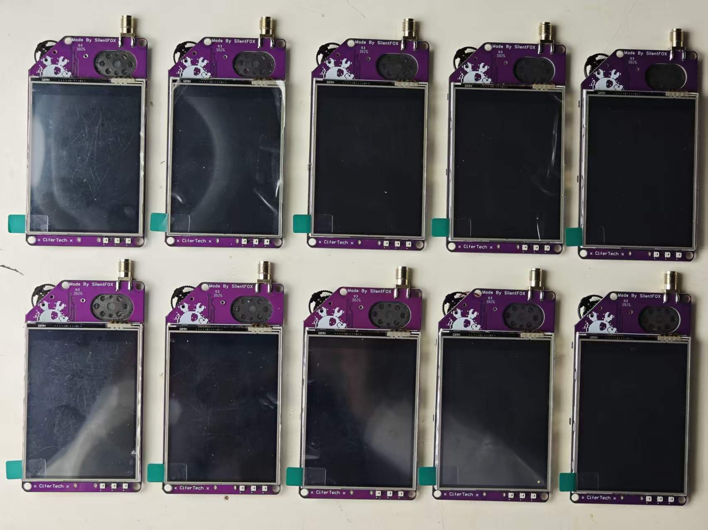
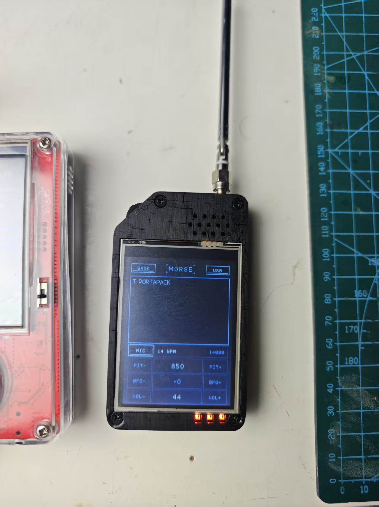
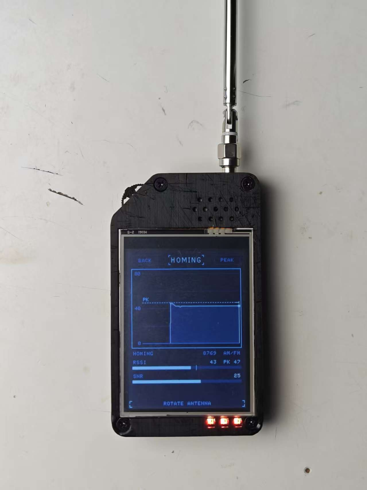
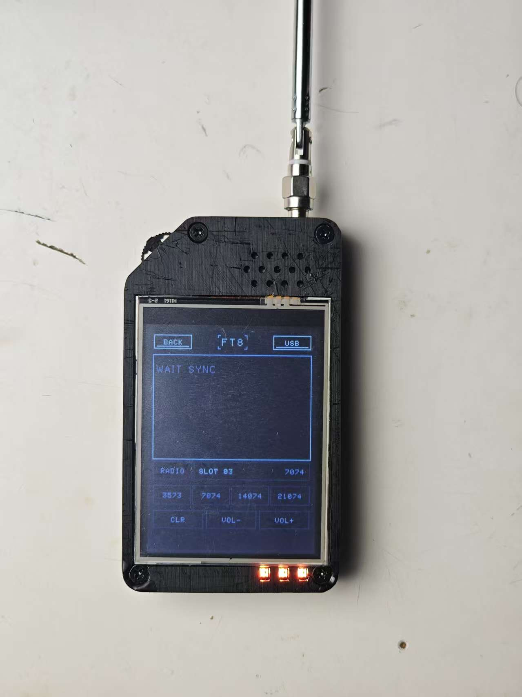

<div align="center">

# FENNEC

**Version 1.1.2** · Original design by CiferTech · Modified by SilentFOX

Handheld shortwave receiver, digital-mode monitor and signal hunter on **ESP32-S3 + SI4732**.

<p>
  
  
  
  
</p>

<p>
  <a href="https://github.com/silentfox2023/Fennec/releases/latest"></a>
  <a href="mailto:btbt520@gmail.com"></a>
  <a href="https://dz-rf.com"></a>
</p>

<table>
  <tr>
    <td align="center">
      
      <p><em>Fennec in hand — FT8 page, 7074 kHz USB</em></p>
    </td>
    <td align="center">
      
      <p><em>Main menu — six built-in tools, all driven by the touchscreen</em></p>
    </td>
  </tr>
</table>

</div>

---

Fennec is a touchscreen radio / digital-mode receiver built around the **ESP32-S3** and the **SI4732**. It combines six functions — radio (FM/AM/SW/SSB), SSTV image reception, CW (Morse) decoding, FT8 digital decoding, signal-strength homing and event logging — plus a Wi-Fi web remote.

This document is the complete user manual for version **1.1.2**.

---

## 1. Hardware and Controls

| Part | Description |
|---|---|
| Display | 2.8" ILI9341 240×320 color TFT with resistive touch |
| Receiver | SI4732 (FM/AM/SW/SSB, I²C) |
| MCU | ESP32-S3, 16 MB flash (module N16R8; PSRAM is not enabled because the display bus occupies its pins) |
| Microphone | I²S digital microphone (MIC input selectable for SSTV/CW/FT8) |
| Indicator | On-board NEOPIXEL |
| Antenna | SMA antenna connector (receive) |

**Controls: everything is done on the touchscreen.** This unit has no physical buttons (the rotary switch is power only); every function is entered by tapping the main menu. If a particular firmware build still carries key-handling code, it has no effect on this hardware and does not affect normal use.

<p align="center">
  
  <br/>
  <em>Fennec main boards — ESP32-S3, ILI9341 display bus and SI4732 receiver on one PCB</em>
</p>

## 2. Power-On and First Use

1. Switch the rotary knob to power on. The screen lights up with the Fennec boot screen and then enters the **main menu**.
2. On first power-up (or whenever touch is inaccurate): go to `SETTINGS → TOUCH` to run touch calibration. You can also type `c` on the serial console to recalibrate, or `C` to clear the calibration data. Calibration is a four-point crosshair procedure (top-left → top-right → bottom-right → bottom-left); the result is stored in NVS (namespace `wbtouch`) and survives power loss.

   > **Touch calibration fix in 1.1.0**: this version rewrites the calibration mapping. Raw touch values are **interpolated onto the actual screen coordinates of the calibration crosshairs** (instead of being extrapolated to the screen edges), and the left/right and top/bottom raw edge values are stored directly so that `map()` handles reversed ranges automatically (no more swapping min/max, no more inversion flags). Before the fix, the Y axis was offset as a whole (you had to press below the VOL- button for it to trigger); even earlier builds had a fully reversed axis (pressing the top-right LSB corner triggered the bottom-left VOL- button). After the fix, wherever you press is where it triggers, and on-screen buttons line up one-to-one with touch points. **Recalibrate once after upgrading from an older version** (old calibration data is incompatible with the new algorithm).
3. The menu has six entries: `01 RADIO` / `02 SSTV` / `03 MORSE` / `04 FT8` / `05 HOMING` / `06 WATCH`. `BACK` in the top-left corner of each page returns to the main menu.

   > **FT8 is a licensed feature**: on an unauthorized device the main menu **does not show the FT8 entry** (the other five work normally), and the serial `f` command and the web FT8 panel are equally unavailable. The boot log on the serial port (115200) prints `[ft8lock] MAC=xxxxxxxxxxxx UNLOCKED` or `LOCKED (hidden)`. If your device is not authorized, contact the device supplier to obtain a license.

## 3. RADIO

- Switch bands with the **FM / MW / SW** tabs; under SW you can further select meter bands.
- **Tuning steps**: FM jumps **100 kHz** (0.1 MHz) per press, AM/SW **10 kHz**, SSB **1 kHz**. The rotary knob and the on-screen `+/-` buttons use the same step; `SEEK` is still the SI4732 automatic scan.
- **Direct frequency entry**: tap the large frequency readout in the middle of the screen to open the full-screen numeric keypad:
  - An integer is interpreted according to the current band: `6075` on AM/SW = 6075 kHz; `1015` on FM = 101.5 MHz, `99` = 99.0 MHz.
  - With a decimal point it is always parsed as MHz: `14.230` is also accepted on AM/SW.
  - If the value is outside the current band, the radio automatically switches to the nearest usable sub-band (for example, entering 14230 while on MW switches to SW); the final value is still clamped inside the band.
  - `DEL` deletes the last digit, `CANCEL` discards, `OK` applies.
- `SEEK` auto-scans, `BAND ±` changes band, `VOL ±` adjusts volume, `MUTE` mutes.
- In SW/SSB mode you can switch between USB/LSB sidebands and adjust the BFO for single-sideband voice reception.

> **Tip**: the `STATE` line below the band strip shows the current step (`STEP 100 KHZ` / `STEP 10 KHZ`); when RDS is available the station name is shown instead.

## 4. SSTV / MORSE / HOMING / WATCH (Overview)

- **SSTV**: receives slow-scan television pictures (Robot 36 and similar modes); the image is drawn line by line on the display. The audio source can be switched between RADIO and MIC.
- **MORSE**: automatic CW / Morse copy, with an adjustable tone-center frequency (`PIT-` / `PIT+` next to the tone readout).
- **HOMING**: signal-strength direction finding; a live bar graph helps you judge where the signal is coming from.
- **WATCH**: threshold event logging; serial `d` replays the log.

<table>
  <tr>
    <td align="center">
      
      <p><em>MORSE page — CW copy at 14 WPM, 850 Hz pitch</em></p>
    </td>
    <td align="center">
      
      <p><em>HOMING page — live RSSI/SNR bars, rotate the antenna for a peak</em></p>
    </td>
  </tr>
</table>

<p align="center">
  
  <br/>
  <em>FT8 page — 15-second slots, 7074 kHz USB, preset buttons 3573 / 7074 / 14074 / 21074</em>
</p>

### 5.6 Web Remote View

Connect a phone or computer to the Fennec hotspot (default SSID `Fennec`, open network) and open `http://192.168.4.1/` in a browser. Tap **FT8** in the navigation bar to see the live decoded message list, switch between MIC and RADIO, and jump to a frequency. If the device is also connected to your home Wi-Fi (STA), it is more convenient to use the STA IP shown on screen.

### 5.7 No-PSRAM Streaming Decode

Although this module is an N16R8, the octal PSRAM pins conflict with the display bus, so the firmware uses a **LittleFS flash streaming scheme** instead: the audio for each slot is first written to flash (two files used alternately), then streamed back during decoding. This means:

- **Entering the FT8 page for the first time formats LittleFS; wait 2–3 seconds** — this is normal;
- At 24/7 continuous decoding, flash write endurance is roughly 1.5 years or more, which is far beyond normal use;
- For everyday use with occasional page entries, the effect on endurance is negligible.

### 5.8 Troubleshooting Checklist When No Messages Appear

1. The status line stays at `NO WIFI` → Wi-Fi is not connected: go to `SETTINGS → WIFI STA`, configure it again (check SSID/password), tap **SAVE**, then tap **CONNECT**, and watch whether the status line changes from `CONNECTING...` to `OK x.x.x.x`.
2. The status line shows `NO NTP` for more than 30 seconds → Wi-Fi is connected but NTP is unreachable: make sure the router can reach the internet (NTP automatically retries three servers: pool.ntp.org / ntp.aliyun.com / ntp.tencent.com); reboot the device and try again; connect the USB serial console (115200) and check the `[clock] NTP` log to see where it stalls.
3. `SLOT` advances but the list stays empty → wrong frequency (always use USB, start at 7074); antenna too short; or no activity on that band at this time of day (try 7074 at local night).
4. A few messages appear but many are garbled or missing → clock drift: make sure NTP keeps working; when using MIC input, check that the level is not overloading.
5. Speaker howl interferes with decoding → press `MUTE` (this only mutes audio, not decoding).
6. To confirm the device is decoding normally → watch the status line flash `DECODING` every 15 seconds.

## 6. Wi-Fi Configuration and Web Remote

### 6.1 Configuring Wi-Fi on the Device (new in 1.1.0)

Path: **main menu top-right ⚙ → WIFI STA** (the fifth row on the settings page; the stored SSID is shown on the right).

Page layout:

```
┌ WIFI ─────────── [BACK] ┐
│ SSID  [ your-wifi-name ]│
│ PASS  [ ************** ]│
│ CONNECTING...           │
│ [  SAVE  ] [ CONNECT  ] │
│  TAP SSID OR PASS TO    │
│  EDIT                   │
│ q w e r t y u i o p     │
│ a s d f g h j k l .     │
│ 12# z x c v b n m   <   │
│ ^       SPACE       OK  │
└─────────────────────────┘
```

Procedure:

1. Tap the **SSID** row → the full-screen soft keyboard opens; tap **12#** to switch to the digit/symbol layer; **^** toggles upper/lower case; **<** is backspace; **OK** dismisses the keyboard.
2. Tap the **PASS** row and enter the password the same way (the password is masked with `*`).
3. Tap **SAVE**: the credentials are written to device storage (they survive power loss) and the status line briefly shows `SAVED`. It does **not** connect immediately.
4. Tap **CONNECT**: the device tries to connect using the current input fields (without saving them); the status line changes to `CONNECTING...` and then to `OK 192.168.x.x` on success.
5. Recommended flow: fill in SSID/PASS → **SAVE** (persist) → **CONNECT** (connect now).
6. The status line has four states: `DISCONNECTED` (not connected) / `CONNECTING...` (connecting) / `OK x.x.x.x` (connected, shows the STA IP) / `SAVED` (saved successfully, reverts after 1.5 seconds).

Notes:

- Credentials are stored in the NVS partition and survive power loss; re-entering this page lets you view or modify them (the password stays masked).
- SSID up to 32 characters, password up to 63 characters.
- A wrong password causes the connection to fail (the status line returns to `DISCONNECTED` after 30 seconds): re-enter this page, correct it and tap **CONNECT** again.
- To connect temporarily without saving: just fill in the fields and tap **CONNECT**, without tapping **SAVE**.
- Clearing both input fields and tapping **SAVE** deletes the stored credentials.
- The `Fennec` hotspot stays open after a STA connection is established (AP+STA dual mode), so you can always get back in to fix the configuration.
- `FENNEC_WIFI_STA_SSID/PASS` in [Config.h](Fennec/Config.h) at compile time are only factory defaults; once Wi-Fi has been saved on the device, the device storage takes precedence.

### 6.2 Web Remote

- Device hotspot: SSID `Fennec` (open network), address `http://192.168.4.1/`; once STA is connected you can also use the IP shown on the status line.
- The web interface includes panels for RADIO tuning/volume/mute, SSTV status, CW, FT8, HOMING and WATCH.
- If STA is not configured or cannot connect, the hotspot method always works (connect to the hotspot first, then open the web page).

## 7. Serial Command Reference (USB serial, 115200)

| Command | Action | Command | Action |
|---|---|---|---|
| `n` / `p` | Next / previous band | `f` | Enter / exit FT8 |
| `[` / `]` | Tune down / up | `t` | Enter / exit SSTV |
| `s` | Seek | `w` | Enter / exit MORSE |
| `+` / `-` | Volume up / down | `h` | Enter / exit HOMING |
| `m` | Toggle mute | `l` | Enter / exit WATCH |
| `v` | Toggle MIC (inside SSTV/CW/FT8 pages) | `d` | Replay WATCH log |
| `c` / `C` | Touch calibration / clear calibration | `i` | Print status information |
| `?` | Command help | | |

## 8. FAQ

- **Q: The touchscreen is inaccurate.** Settings → TOUCH calibration; or serial `c`.
- **Q: Can it transmit?** No. Fennec is a receive-only receiver; FT8 is decoded and displayed only.
- **Q: Can FT8 decode offline?** No. Slot alignment depends on NTP, so keep the device online (Wi-Fi is configured on the device, see section 6).
- **Q: How do I change Wi-Fi networks?** Settings → WIFI STA, enter the new values, **SAVE** then **CONNECT**; or clear both input fields and **SAVE** to delete the stored credentials.
- **Q: Why is there no more PSRAM error?** Since 1.1.0, FT8 uses LittleFS streaming decode and no longer depends on PSRAM.
- **Q: How do I restore the factory touch calibration?** Serial `C`, then reboot and calibrate again.

## 9. Technical Specifications

| Item | Specification |
|---|---|
| Firmware version | 1.1.2 |
| Receive range | FM 64–108 / MW / SW 2.3–26.1 MHz (SI4732) |
| SSB fine tuning | Adjustable BFO |
| FT8 presets | 3573 / 7074 / 14074 / 21074 kHz (USB) |
| FT8 decoding | 8FSK + Costas + LDPC(174,91), 15 s slots, about 1–2 s per slot |
| FT8 audio source | SI4732 ADC input / I²S microphone |
| Message buffer | 32 messages on screen / live push to the web UI |
| Flash partitioning | 16 MB; FT8 uses ~1.4 MB LittleFS streaming buffer |
| Touch calibration | Four-point interpolated mapping, stored in the NVS `wbtouch` namespace |

---

## 10. Changelog

### v1.1.2 (2026-10-31)

- Fixed the SI4732 frequency storage unit pitfall (FM 10 kHz / AM-SW 1 kHz)
- Added a "direct frequency entry" section: integer/decimal parsing rules, automatic band switching, DEL/CANCEL/OK operation

### v1.1.1 (2026-10-25)

**New: FT8 license lock**

- FT8 becomes a **licensed** feature: the device MAC address must be in the firmware whitelist; unauthorized devices hide the FT8 entry in the main menu
- Authorization is based on the Wi-Fi STA MAC in eFuse, which cannot be altered in software; a dumped firmware image cannot be used to forge authorization
- All entry points are gated: main-menu touch, serial `f` command, and the web FT8 panel
- The boot serial log shows the local MAC and authorization state: `[ft8lock] MAC=XXXXXXXXXXXX UNLOCKED/LOCKED`
- How to get authorized: contact the device supplier, provide the device MAC, and the licensor recompiles and flashes the firmware

### v1.1.0 (2026-10-18)

**No-PSRAM streaming decode architecture**

- The module is an N16R8, but the octal PSRAM pins (GPIO33–37) physically conflict with the display bus, so PSRAM is abandoned
- FT8 moves to a LittleFS flash streaming scheme: slot audio is written to `/ft8a.raw` and `/ft8b.raw` in a ping-pong pattern (187.5 KB each, 8 KB write buffer to spread erase/write load); the waterfall stores only sub=0 rows (8-bit half-dB, 83.5 KB in internal RAM); the +80 ms fine-timing frame is recomputed from file on demand when error correction fails (limited to 24 attempts per slot)
- Entering the FT8 page for the first time formats LittleFS (waiting 2–3 seconds is normal)

**On-device Wi-Fi configuration (no more code editing and recompiling)**

- New fifth settings entry **WIFI STA** (shows the stored SSID on the right) → a dedicated configuration page: SSID/PASS input rows (password masked) + full-screen soft keyboard (QWERTY / 12# symbol layer / case toggle / backspace / space) + **separate SAVE / CONNECT buttons**
- Credentials stored in NVS (namespace `fennec`, keys ssid/pass) and survive power loss; **SAVE** only persists, **CONNECT** only connects (so you can connect temporarily without saving); `FENNEC_WIFI_STA_SSID/PASS` in Config.h is downgraded to a factory default
- AP+STA dual mode: the `Fennec` hotspot always stays open for rescue configuration; the status line has four states `DISCONNECTED / CONNECTING... / OK x.x.x.x / SAVED`
- Clearing both input fields and tapping SAVE deletes the stored credentials
- **Three NTP servers** (pool.ntp.org / ntp.aliyun.com / ntp.tencent.com) with 15-second retry, fixing FT8 being stuck at NO UTC when pool.ntp.org is unreachable in some regions

**Touch calibration fix (TouchCal)**

- Symptom: the Y axis was offset as a whole — VOL- had to be pressed some distance below the button to trigger; earlier builds had a fully reversed axis where pressing the top-right LSB corner triggered the bottom-left VOL- button
- Root cause: the old algorithm **extrapolated the calibration samples to the screen edges** (0, max), amplifying edge sampling error into a global offset; and the old logic swapped min/max and relied on inversion flags, so axes were easily flipped
- Fix: **interpolate onto the actual screen coordinates of the calibration crosshairs** (crosshairs are drawn 10 px inside the screen, and the mapping target is the crosshair coordinate itself, with zero extrapolation); store the raw left/right and top/bottom edge values directly and let `map()` handle reversed ranges (no more swapping min/max, no inversion flag, only the XY-swap bit is kept)
- Upgrade note: old calibration data is incompatible with the new algorithm, **please run the four-point calibration again after upgrading** (hold OK while powering on / serial `c` / Settings → TOUCH)

---

## 📥 Firmware and Flashing

Pre-built firmware for **ESP32-S3 (16 MB flash)** is published on the [Releases](https://github.com/silentfox2023/Fennec/releases) page. Only binary images are attached to a release; the source code lives in this repository.

**Board / partition settings (required):**

| Setting | Value |
|---|---|
| Board | ESP32S3 Dev Module (`esp32:esp32:esp32s3`) |
| Flash size | 16 MB |
| Partition scheme | `app3M_fat9M_16MB` (3 MB app / 9 MB FAT) |
| PSRAM | Disabled (pins conflict with the display bus) |

**Flashing with esptool:**

```bash
esptool.py --chip esp32s3 -p <PORT> -b 921600 write_flash \
  0x0     Fennec-1.1.2-esp32s3.bin
```

Use the Arduino IDE or `arduino-cli` to build from source with the board options above.

## 💬 Support and Contributions

- Found a bug or have a feature request? Open an [Issue](https://github.com/silentfox2023/Fennec/issues)
- Like the project? Star the repository.
- Want to contribute? Fork it and submit a pull request.

## :warning: License

MIT © CiferTech. See [LICENSE](LICENSE).

## :handshake: Contact

- Mail: btbt520@gmail.com
- GitHub: [github.com/silentfox2023](https://github.com/silentfox2023)
- Web: [dz-rf.com](https://dz-rf.com)

Project link: [https://github.com/silentfox2023/Fennec](https://github.com/silentfox2023/Fennec)

## :gem: Acknowledgements

- [PU2CLR SI4735](https://github.com/pu2clr/SI4735) (Ricardo Caratti)
- [TFT_eSPI](https://github.com/Bodmer/TFT_eSPI) (Bodmer)
- [XPT2046_Touchscreen](https://github.com/PaulStoffregen/XPT2046_Touchscreen) (Paul Stoffregen)
- [ESP32-DIV](https://github.com/cifertech/ESP32-DIV) — same ESP32-S3 / ILI9341 / XPT2046 bus layout
- Original Fennec design by [CiferTech](https://github.com/cifertech/Fennec)
